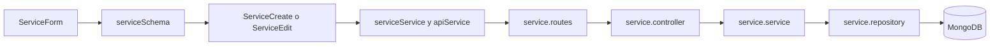

# Catálogo público: fase 1

## Alcance de esta fase

Esta entrega separa el servicio genérico de sus modalidades de contratación.
`Service` describe qué trabajo se ofrece y `Variant` describe cómo se contrata.
Por eso, el nombre, la categoría y la descripción pertenecen a Service; el
precio y la duración pertenecen a cada Variant.

En esta fase solo se ha realizado ese cambio de modelo y administración. Home,
Shop List, Shop Detail y sus nuevos endpoints todavía no están implementados.

## Modelo y contratos

Un Service nuevo necesita `name` y `category`. También puede recibir
`description`, `active` y `status`; el servidor genera el `slug`. El endpoint
administrativo continúa siendo `POST /api/services`, protegido por autenticación
y rol ADMIN.

Ejemplo válido:

```http
POST /api/services
Authorization: Bearer <token ADMIN>
Content-Type: application/json
```

```json
{
  "name": "Limpieza de viviendas",
  "category": "65a1b2c3d4e5f67890123456",
  "description": "Limpieza de espacios interiores.",
  "active": true,
  "status": "published"
}
```

`price` y `duration` ya no son propiedades de Service. En POST y PATCH se
rechazan con HTTP 400 si se envían, incluso cuando su valor es `null`. El
validador HTTP de `service.routes.js` informa el error antes del controlador;
`sanitizeInput` en `service.service.js` mantiene la misma regla para llamadas
internas que no atraviesen Express.

Una respuesta de Service conserva sus demás propiedades y la categoría
poblada, pero no devuelve precio ni duración:

```json
{
  "_id": "65a1b2c3d4e5f67890123457",
  "name": "Limpieza de viviendas",
  "category": {
    "_id": "65a1b2c3d4e5f67890123456",
    "name": "Hogar",
    "slug": "hogar",
    "active": true,
    "deletedAt": null
  },
  "description": "Limpieza de espacios interiores.",
  "active": true,
  "deletedAt": null,
  "status": "published",
  "slug": "limpieza_de_viviendas"
}
```

La respuesta real también puede incluir `createdAt` y `updatedAt`.
`ServiceInput` en Swagger refleja ahora los campos admitidos y requiere solo
nombre y categoría. La autorización de las rutas administrativas no cambia.

## Responsabilidad de Variant

`Variant.price` y `Variant.duration` permanecen obligatorios. El precio admite
cero o un valor positivo; la duración es un entero positivo en minutos. La
generación del SKU automático sigue usando el slug del Service y la duración de
la Variant. Los formularios y las rutas de Variant no se modifican en esta fase.

El carrito también conserva la relación con Variant: `cart.repository.js`
recupera precio y duración de esa modalidad, y `cart.service.js` calcula el
subtotal del pedido con el precio de la variante en el servidor. Al confirmar el
checkout, `Order` guarda una copia inmutable del precio y duración junto con los
nombres y el SKU. Esa copia es el historial de la compra y no debe recalcularse
al cambiar una Variant.

## Datos históricos

Quitar una propiedad del esquema Mongoose no elimina automáticamente el campo
de los documentos que ya existen. Esta fase **no ejecuta una migración física**:
si una fila antigua de Service guarda `price` o `duration`, esos valores siguen
en MongoDB, pero dejan de formar parte del modelo y del contrato de la API.

Las consultas del repositorio usan `.select("-price -duration")` antes de
`.lean()`. `lean()` devuelve objetos JavaScript planos sin aplicar la
serialización de documentos hidratados de Mongoose; por eso la proyección
explícita es necesaria para que valores antiguos no reaparezcan en respuestas.
La prueba `test/service-contract.test.js` inspecciona esa proyección sin abrir
una conexión a la base de datos.

El seed normal solo inserta ejemplos que faltan: no limpia ni actualiza los
servicios ya guardados. Sus datos de Service ya no incluyen esos campos y sus
datos de Variant sí los conservan. No se ejecutó el seed. El script
`migrate-services.js` completa estado, slug y fecha de borrado; no forma parte
de este cambio ni borra precio o duración.

Si más adelante se quisiera eliminar físicamente los dos campos de documentos
antiguos, haría falta una migración separada, con respaldo, revisión del
entorno y autorización expresa. Los precios/duraciones históricos de Order no
se deben borrar ni modificar.

## Flujo administrativo



`ServiceForm` prepara el body desde sus campos editables. `serviceSchema`
comprueba el nombre, el ID de categoría y el resto de datos propios del
servicio. Las páginas Create/Edit comparan esos mismos campos antes de decidir
si hace falta actualizar la entidad o basta con sincronizar sus imágenes.
`service.service.js` vuelve a validar el body y genera un slug único; el
repositorio conserva la relación poblada con Category y excluye las propiedades
comerciales antiguas de las respuestas.

La tabla de administración muestra identidad, categoría, estado y acciones. Ya
no presenta un precio o una duración genéricos que podrían contradecir las
variantes del servicio. El precio y tiempo se siguen editando desde la gestión
de variantes.

## Archivos que conviene estudiar

- Backend: `src/models/service.model.js`, `src/services/service.service.js`,
  `src/repositories/service.repository.js`, `src/routes/service.routes.js` y
  `src/config/swagger.js`.
- Administración frontend: `src/features/services/serviceSchema.js`,
  `src/features/services/components/ServiceForm.jsx`,
  `src/pages/services/ServiceCreate.jsx`, `ServiceEdit.jsx` y `ServiceList.jsx`.
- Precio y duración comerciales: `src/models/variant.model.js`,
  `src/services/variant.service.js`, `src/services/cart.service.js` y
  `src/models/order.model.js`.

## Verificación

Las comprobaciones sin MongoDB de esta fase son:

```powershell
node --test --test-reporter=tap test/catalog-authorization.test.js
node --test --test-reporter=tap test/service-contract.test.js
npm --prefix ..\frontend run build
```

Las pruebas de integración de imágenes, variantes y carrito/pedidos necesitan
`MONGODB_TEST_URI` local con una base cuyo nombre empiece por `fixly_test_`.
Comprueban datos en esa base y la eliminan al terminar; no se ejecutan sin
confirmar que la URI apunta a una base de pruebas aislada.

## Decisiones fuera de alcance

- No se trasladan automáticamente valores antiguos de Service a Variant.
- No se crean variantes para servicios que no las tengan.
- No se elimina físicamente ningún campo de MongoDB.
- No se modifican campos ni snapshots de Variant, Cart u Order.
- No se implementan aún búsquedas, precios calculados ni endpoints del catálogo.