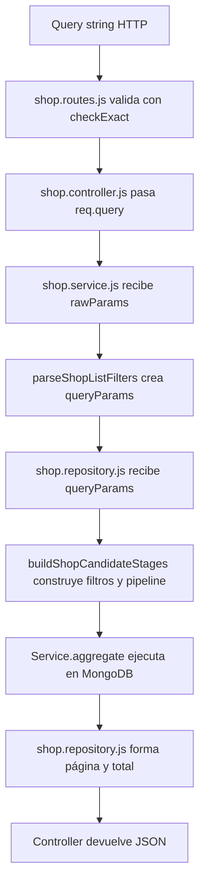
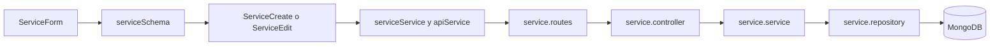

# Catálogo público: fases 1, 2, 3 y 3.1

## Alcance de esta fase

Esta entrega separa el servicio genérico de sus modalidades de contratación.
`Service` describe qué trabajo se ofrece y `Variant` describe cómo se contrata.
Por eso, el nombre, la categoría y la descripción pertenecen a Service; el
precio y la duración pertenecen a cada Variant.

La fase 1 realizó ese cambio de modelo y administración. La fase 2 añade el
endpoint backend de categorías para Home. La fase 3 añade los endpoints backend
de Shop List; Shop Detail y el frontend público siguen pendientes.

La fase 3.1 consolida la forma de construir los filtros, el flujo
`rawParams → queryParams → repository`, la validación compartida y la
documentación. No cambia los contratos de Home o Shop ni comienza Shop Detail.

## Fase 2: categorías para Home

`GET /api/home/categories` es una operación pública de solo lectura y no
requiere Bearer JWT. Devuelve únicamente los campos necesarios para las tarjetas
de inicio: nombre, slug para navegación y primera imagen (o `null`). No devuelve
IDs internos, estados ni documentos completos de categoría, servicio o variante.

Ejemplo de petición:

```http
GET /api/home/categories
```

Respuesta ilustrativa:

```json
[
  {
   "name": "Fontanería",
   "slug": "fontaneria",
   "image": {
    "url": "https://example.invalid/fontaneria.jpg",
    "alt": "Reparación de un grifo"
   }
  },
  {
   "name": "Jardinería",
   "slug": "jardineria",
   "image": null
  }
]
```

La respuesta real es un array; una categoría sin imágenes mantiene su lugar y
recibe `image: null`. Las categorías se ordenan por nombre y slug.

### Consulta y disponibilidad

La ruta `home.routes.js` no monta autenticación. `home.controller.js` delega en
`home.service.js`, que llama a `home.repository.js`; allí se ejecuta una sola
agregación desde la colección Service. Sus etapas implementan estas reglas:

1. `$match` descarta servicios inactivos, no publicados o eliminados. Category
  no tiene estado de publicación.
2. `$lookup` busca para cada servicio una variante activa, publicada y no
  eliminada. La correlación por `service` usa el prefijo del índice existente
  `{service, active, status, deletedAt}` de Variant. `$limit: 1` evita cargar
  variantes completas: solo hace falta saber que existe al menos una.
3. `$match` elimina servicios sin variantes elegibles.
4. `$group` reúne los servicios restantes por ID de categoría. Si tres servicios
  de la misma categoría son elegibles, el grupo conserva una sola categoría.
5. `$lookup` recupera Category por su `_id`; `$unwind` elimina relaciones
  inexistentes y otro `$match` exige categoría activa y no eliminada. Esta
  comprobación ocurre después de la disponibilidad propia de Service/Variant,
  no cambia los estados en cascada.
6. `$lookup` encuentra imágenes `entityType: "category"` de esa categoría,
  ordena por `createdAt` ascendente y `_id` como desempate estable, y limita la
  relación a una imagen. Ese es el criterio de “primera imagen”; coincide con
  el orden temporal de la galería.
7. `$project` convierte la primera coincidencia en `image` y expone solamente
  `name`, `slug` e imagen. Si el array de imágenes está vacío, `$ifNull`
  produce `null`. `$sort` final ordena las tarjetas por nombre y slug.

El pipeline no usa `$unwind` sobre servicios ni variantes: junto con `$group`,
esto evita duplicar una categoría por tener múltiples ofertas. Las relaciones
se consultan dentro de la agregación, no mediante una consulta por cada tarjeta,
por lo que no se genera el patrón N+1.

El índice de Variant cubre la búsqueda correlacionada por servicio, filtros de
estado y soft delete. Images ya dispone de `{entityType, entityId, createdAt}`.
No se añadió ningún índice en Service: el pipeline recorre esa colección una
vez y el tamaño real de producción no está disponible. Antes de añadir un índice
para ese filtro se debería medir `explain("executionStats")` con datos
representativos y valorar su coste de escritura, almacenamiento y despliegue.

### Pruebas y documentación

`home-public.test.js` comprueba el acceso sin token, las condiciones del pipeline,
el agrupamiento y el orden de imagen. `home.integration.test.js` prepara casos
reales para categorías y ofertas no disponibles, varias ofertas por categoría
y orden de imágenes. Esta integración solo se ejecuta con
`MONGODB_TEST_URI` local y nombre `fixly_test_*`; elimina esa base al terminar.
Swagger describe el endpoint y los campos de su respuesta.

## Fase 3: Shop List

Shop añade dos endpoints públicos de solo lectura:

- `GET /api/shop/services` busca tarjetas de servicio con categorías, texto,
  precios, orden y paginación.
- `GET /api/shop/filters` devuelve todas las categorías elegibles y el rango de
  precios adaptado a `categories` y `search`.

Ejemplo de búsqueda:

```http
GET /api/shop/services?categories=limpieza,carpinteria&search=vivienda&minPrice=20&maxPrice=100&sort=price-asc&limit=12&offset=0
```

Respuesta ilustrativa:

```json
{
  "items": [
    {
      "name": "Limpieza de hogar",
      "slug": "limpieza_de_hogar",
      "description": "Limpieza de espacios domésticos.",
      "category": { "name": "Limpieza", "slug": "limpieza" },
      "image": {
        "url": "https://example.invalid/limpieza.jpg",
        "alt": "Limpieza de una vivienda"
      },
      "priceFrom": 25
    }
  ],
  "total": 1,
  "limit": 12,
  "offset": 0
}
```

La respuesta no incluye SKU, duración, IDs ni estados internos. `description` e
`image` pueden ser `null`; el precio mostrado `priceFrom` es el mínimo de las
variantes que cumplen las condiciones aplicables.

Ejemplo de opciones adaptativas:

```http
GET /api/shop/filters?categories=limpieza&search=profunda
```

```json
{
  "categories": [
    { "name": "Carpintería", "slug": "carpinteria" },
    { "name": "Limpieza", "slug": "limpieza" }
  ],
  "priceRange": { "min": 125, "max": 125 }
}
```

Las categorías de opciones son globales y no dependen de la búsqueda. El rango
sí usa categorías y búsqueda, pero ignora los precios aplicados, la ordenación y
la paginación. Si no queda ninguna variante candidata, ambos límites son `null`.

### Validación de filtros

`parseShopListFilters` en `shop-filters.util.js` convierte los query params en
valores primitivos seguros antes de llegar al repositorio. Rechaza arrays,
claves desconocidas, tipos inesperados, slugs mal formados, búsqueda de más de
100 caracteres, precios no finitos/negativos, `minPrice > maxPrice`, orden no
permitido, `limit` fuera de 1–50 y offsets que no sean enteros no negativos.
Los defaults son `sort=name-asc`, `limit=12` y `offset=0`. El precio cero es un
límite válido y no representa ausencia de filtro.

`categories` es una lista CSV: los slugs repetidos se deduplican y los slugs
existentes se combinan con OR. Un slug sintácticamente válido pero inexistente
no provoca error y no impide que otros slugs válidos den resultados. Categorías,
búsqueda y precio se combinan con AND.

## Construcción dinámica: metodología y flujo completo



`checkExact` ejecuta las cadenas `express-validator` declaradas en la ruta y
rechaza claves no enumeradas. Las cadenas invocan los parsers comunes del
servicio para no mantener una segunda gramática. También convierten `minPrice`,
`maxPrice`, `limit` y `offset` a números. Por eso `rawParams` en `shop.service.js`
es el objeto `req.query` ya validado por HTTP, aunque el servicio vuelve a
validarlo para cubrir llamadas internas. `queryParams` es la representación
normalizada que recibe el repositorio.

### Ejemplo 1: listado sin filtros

Petición:

```http
GET /api/shop/services
```

Valores al entrar en el servicio:

```js
rawParams = {};
queryParams = {
  categories: [],
  search: "",
  minPrice: undefined,
  maxPrice: undefined,
  sort: "name-asc",
  limit: 12,
  offset: 0,
};
```

`buildShopCandidateStages(queryParams)` crea los filtros obligatorios de
disponibilidad. No añade slug, precio ni comparación textual. El pipeline busca
servicios activos/publicados/no eliminados, categorías activas/no eliminadas y
variantes activas/publicadas/no eliminadas. Calcula el mínimo disponible,
ordena por nombre, y `$facet` produce la primera página y el total previo a
paginar.

### Ejemplo 2: categorías y precio

Petición:

```http
GET /api/shop/services?categories=limpieza,carpinteria&maxPrice=50
```

Tras validación y normalización:

```js
rawParams = { categories: "limpieza,carpinteria", maxPrice: 50 };
queryParams = {
  categories: ["limpieza", "carpinteria"],
  search: "",
  minPrice: undefined,
  maxPrice: 50,
  sort: "name-asc",
  limit: 12,
  offset: 0,
};
```

En `buildShopCandidateStages` los objetos conceptuales quedan así:

```js
serviceFilter = { active: true, status: "published", deletedAt: null };
categoryFilter = {
  active: true,
  deletedAt: null,
  slug: { $in: ["limpieza", "carpinteria"] },
};
variantFilter = {
  active: true,
  status: "published",
  deletedAt: null,
  price: { $lte: 50 },
};
```

Cada `$lookup` añade la correlación por ObjectId mediante `$expr`. `$in` admite
cualquiera de las dos categorías; el `$match` de precio se añade solo porque
`maxPrice` está definido. Un slug válido que no exista simplemente no encuentra
Category; otros slugs del mismo `$in` todavía pueden coincidir.

### Ejemplo 3: búsqueda y precio

Supongamos tres variantes disponibles: básica `25 €`, completa `75 €` y
profunda `125 €`.

```http
GET /api/shop/services?search=profunda&maxPrice=50
```

El lookup filtra primero por disponibilidad y precio. La variante profunda no
queda en `availableVariants`; `$filter` no puede encontrar el texto y el
servicio se descarta, aunque la básica sí esté por debajo de `50 €`.

```http
GET /api/shop/services?search=profunda&maxPrice=150
```

Ahora la profunda sí está en `availableVariants` y coincide con `searchText`.
Como no coincide el nombre/descripción de Service ni Category, `$cond` asigna
solo esa variante a `eligibleVariants`; el resultado tiene `priceFrom: 125`.
La básica no puede satisfacer el precio por separado para hacer aparecer el
servicio.

### Ejemplo 4: ordenación y paginación

```http
GET /api/shop/services?sort=price-asc&limit=12&offset=12
```

1. Los candidatos y `eligibleVariants` se determinan antes de paginar.
2. `$min` calcula `priceFrom` de cada servicio.
3. `$sort: {priceFrom: 1, _id: 1}` ordena por el mismo importe de la tarjeta y
  usa `_id` para desempatar de forma estable.
4. `$facet.metadata` cuenta servicios, no variantes.
5. `$facet.results` omite los primeros 12 y toma los siguientes 12. Si `offset`
  supera el total, devuelve `items: []` y conserva `total`.

No se cambia ningún filtro ni el offset para “corregir” una página vacía.

### Ejemplo 5: límites adaptativos

```http
GET /api/shop/filters?categories=limpieza&search=profunda
```

`shop.service.getFilterOptions` llama con `Promise.all` a la lista global de
categorías de `home.service.listCategoryOptions()` y a
`shop.repository.findAdaptivePriceRange(queryParams)`. El segundo método crea
explícitamente `adaptiveQueryParams` con las mismas categorías y búsqueda, y
`minPrice`/`maxPrice` ausentes. Reutiliza el mismo `buildShopCandidateStages`,
después `$unwind` temporalmente `eligibleVariants` y agrupa `$min` y `$max`.
No añade `$sort`, `$skip` ni `$limit`. Sin filas, el repositorio devuelve dos
límites `null`.

### Ejemplo 6: búsqueda insensible a acentos

```text
Fuente:    "Limpieza de áticos"
searchText: "limpieza de aticos"
Query:     "  ÁTICOS "
Normalizado: "aticos"
```

`normalizeCatalogSearchText` aplica Unicode NFD: por ejemplo, `á` se separa en
`a` y una marca combinante; `\p{M}` elimina esa marca. Después pasa a
minúsculas, colapsa espacios y recorta extremos. Category normaliza el nombre;
Service y Variant unen nombre y descripción antes de normalizar. El query pasa
por la misma utilidad. `escapeSearchRegex` convierte metacaracteres en texto
literal; `a+b` no se interpreta como una repetición regex.

### Ejemplo 7: simulación de migración

El dry-run es el modo predeterminado. Lee colecciones con cursor, no llama a
`connectDB()`, no ejecuta `bulkWrite`, no crea colecciones/índices y no cambia
`updatedAt`. Informa por colección documentos examinados, sin `searchText`, con
valor obsoleto, correctos, previstos para update y errores de normalización.

#### Simulación sobre una base de pruebas

Para comprobar el script sin leer ni tocar la base de desarrollo, desde
`backend` toma la URI de `MONGODB_TEST_URI` de `.env`. El siguiente bloque
comprueba el destino, no imprime la URI y restaura las variables de entorno
al terminar, incluso si se produce un error:

```powershell
$previousUri = $env:MONGODB_URI
$previousDb = $env:CATALOG_SEARCH_BACKFILL_DB_NAME
try {
    $testUriLine = Get-Content .env | Where-Object { $_ -match '^\s*MONGODB_TEST_URI\s*=' } | Select-Object -First 1
    if (-not $testUriLine) { throw "Falta MONGODB_TEST_URI en .env" }
    $testUri = ($testUriLine -split '=', 2)[1].Trim().Trim('"').Trim("'")
    $parsedUri = [uri]$testUri
    $databaseName = [uri]::UnescapeDataString($parsedUri.AbsolutePath).Trim('/')
    if ($parsedUri.Host -notin @('localhost', '127.0.0.1', '[::1]') -or $databaseName -notmatch '^fixly_test_[a-z0-9_]+$') { throw "Destino no permitido: usa una base local fixly_test_*" }
    $env:MONGODB_URI = $testUri
    $env:CATALOG_SEARCH_BACKFILL_DB_NAME = $databaseName
    npm run migrate:catalog-search-text -- --dry-run
    if ($LASTEXITCODE -ne 0) { throw "Error en la simulación" }
} finally {
    $env:MONGODB_URI = $previousUri
    $env:CATALOG_SEARCH_BACKFILL_DB_NAME = $previousDb
}
```

Una base de pruebas vacía puede devolver cero documentos. Este resultado no
permite conocer cuántos documentos de desarrollo necesitan actualizarse.

#### Simulación sobre la base de desarrollo

Para obtener ese diagnóstico, revisar localmente la URI `MONGODB_URI` de `.env`
y confirmar el servidor y el nombre exacto de la base de desarrollo. Usar una
terminal nueva de PowerShell, desde `backend`, sin una URI heredada de pruebas.
El siguiente comando utiliza la configuración de desarrollo de `.env`:

```powershell
Remove-Item Env:MONGODB_URI -ErrorAction SilentlyContinue
Remove-Item Env:ALLOW_CATALOG_SEARCH_BACKFILL -ErrorAction SilentlyContinue
$env:CATALOG_SEARCH_BACKFILL_DB_NAME = "<nombre exacto revisado>"
npm run migrate:catalog-search-text -- --dry-run
```

Sustituir el marcador por el nombre comprobado antes de ejecutar. No utilizar
`--apply` durante esta comprobación. Cerrar la terminal dedicada al finalizar.

#### Interpretación del informe

Revisar `mode`, `database`, `documentsExamined`, `missingSearchText`,
`staleSearchText`, `alreadyCorrect`, `wouldUpdate`, `modified` y `errors` por
colección. Confirmar que el destino es el esperado y que `modified` es cero.
`wouldUpdate` indica la cantidad que se modificaría. Si `errors` es distinto
de cero, detener el proceso y examinar el esquema o dato afectado antes de
aplicar nada. Comparar `documentsExamined` con el volumen esperado.

#### Aplicación real y verificación posterior

El apply real **no forma parte de esta fase y no se ejecutó**. Solo después de
una autorización expresa, una copia de seguridad, una simulación sobre el mismo
destino y confirmar que no hay cambios administrativos concurrentes, se puede
configurar la URI autorizada localmente en una terminal dedicada, sin mostrarla
en logs, y ejecutar:

```powershell
$env:MONGODB_URI = "<URI del destino autorizado, introducida localmente>"
$env:CATALOG_SEARCH_BACKFILL_DB_NAME = "<nombre exacto revisado>"
$env:ALLOW_CATALOG_SEARCH_BACKFILL = "true"
npm run migrate:catalog-search-text -- --apply
```

`--apply` comprueba el nombre de la URI y de la conexión; la actualización
incluye el snapshot de los campos fuente para saltar cambios concurrentes.
`bulkWrite` usa `timestamps:false`, así solo cambia `searchText`. Si hay
`skippedConcurrentChanges`, volver a simular y revisar antes de repetir.

Tras una aplicación correcta, retirar la autorización de escritura y volver a
simular sobre el mismo destino:

```powershell
Remove-Item Env:ALLOW_CATALOG_SEARCH_BACKFILL -ErrorAction SilentlyContinue
npm run migrate:catalog-search-text -- --dry-run
```

Comprobar que `wouldUpdate`, `modified` y `errors` son cero. Si no lo son,
investigar antes de continuar. Cerrar la terminal dedicada para no reutilizar
accidentalmente las variables de conexión o autorización.

### Orden recomendado de lectura

1. `src/routes/shop.routes.js`: whitelist, validación HTTP y endpoints.
2. `src/controllers/shop.controller.js`: traslado de `req.query` a la capa de
  servicio y propagación de errores.
3. `src/services/shop.service.js`: `rawParams` → `queryParams` y coordinación
  de categorías/rango adaptativo.
4. `src/utils/shop-filters.util.js`: defaults, validación defensiva y conversión.
5. `src/repositories/shop.repository.js`, empezando por
  `buildShopCandidateStages`, después `findServices` y
  `findAdaptivePriceRange`.
6. `src/utils/catalog-availability.util.js` y
  `src/utils/catalog-search.util.js`: predicados compartidos y texto derivado.
7. `src/migrate-catalog-search-text.js` y su integración de prueba para revisar
  el mantenimiento de documentos previos.

La búsqueda se trimea, limita a 100 caracteres, pasa a minúsculas y se normaliza
con Unicode NFD para retirar marcas diacríticas. `escapeSearchRegex` escapa los
metacaracteres; por ejemplo, `a+b` se busca literalmente y no amplía el patrón.
Category genera `searchText` desde el nombre; Service y Variant lo generan a
partir del nombre y descripción. Es un campo interno `select:false`, no se acepta
desde el cliente y no aparece en las respuestas ordinarias.

### Pipeline de Shop

`shop.repository.js` construye la consulta con los nombres de colección de los
modelos. Se parte de Service para filtrar primero servicios activos, publicados
y no eliminados. A continuación:

1. `$lookup` une la Category correspondiente y descarta las que no están activas
   o fueron eliminadas. Si hay `categories`, `$in` aplica OR dentro del grupo.
2. `$lookup` correlaciona variantes por `service` y exige variante activa,
   publicada y no eliminada. El rango se aplica dentro de ese lookup, antes de
   buscar texto. No se hace `$unwind` en la lista, así cada fila sigue siendo un
   único Service aunque tenga muchas variantes.
3. Si hay búsqueda, `$regexMatch` comprueba el `searchText` de Service y Category;
   `$filter` selecciona las variantes cuyo propio texto coincide. Si el texto
   coincide con Service o Category, `eligibleVariants` son las variantes que
   cumplen el rango. Si coincide **solo** con variantes, son únicamente las
   variantes que cumplen texto y rango a la vez. No se permite que una variante
   aporte texto y otra distinta aporte el precio.
4. `$min` calcula `priceFrom` sobre `eligibleVariants.price`, que es exactamente
   el valor que se muestra en la tarjeta y se usa para ordenar por precio.
5. `$sort` usa el orden solicitado antes de `$facet`; `_id` desempata de forma
   estable. `$facet` cuenta todos los servicios coincidentes antes de paginar y
   su rama `results` aplica `$skip` y `$limit`. Un offset posterior al total
   produce `items: []` sin modificar filtros ni total.
6. La imagen se une solo para los resultados de la página y se ordena por
   `createdAt` y `_id`, limitando a la primera. No hay una petición por tarjeta.

Para `priceRange`, el repositorio reutiliza los mismos candidatos y la misma
regla de coincidencia, pero desactiva min/max y no añade sort ni paginación.
Después descompone las variantes elegibles y agrupa `$min`/`$max`; un resultado
vacío se transforma en `{ "min": null, "max": null }`, nunca Infinity o NaN.

### Variant.description y migración de búsqueda

Variant no tenía descripción. Se añadió como campo opcional, recortado y con
límite de 500 caracteres en el modelo, servicio, validadores, Swagger y formulario
administrativo. No es requisito para variantes antiguas.

El campo `searchText` se deriva en hooks `pre("validate")` para cubrir inserts
directos y en los servicios para actualizaciones. Los registros existentes no
se actualizan automáticamente. El script
`src/migrate-catalog-search-text.js` contiene un backfill por cursor y lotes;
solo actualiza el campo derivado y se puede repetir. Por defecto funciona en
modo dry-run; `--apply` exige la confirmación adicional
`ALLOW_CATALOG_SEARCH_BACKFILL=true`. **No se ha ejecutado sobre datos de
desarrollo.**

El procedimiento de simulación, autorización, aplicación y verificación se
centraliza en [Ejemplo 7: simulación de migración](#ejemplo-7-simulación-de-migración).
El informe no imprime host ni credenciales. Mongoose se conecta con
`autoIndex:false` y `autoCreate:false`; el script no llama a `connectDB()` ni
crea índices. Los lotes limitan el uso de memoria. El filtro de cada escritura
compara `_id`, campos fuente y el `searchText` leído: si alguien modifica el
nombre o la descripción durante el recorrido, esa actualización se salta y se
reporta para volver a revisar. `timestamps:false` evita tocar `updatedAt`.

### Sincronización de searchText

- `Category`, `Service` y `Variant` lo calculan en `pre("validate")`, cubriendo
  `Model.create()` y `document.save()`; el seed existente usa `create()` para
  estas entidades.
- Las ediciones de nombre y descripción usan `findOneAndUpdate()`. Esa operación
  no ejecuta el middleware de documento `pre("validate")`, así que
  `categoryService.update`, `serviceService.update` y `variantService.update`
  calculan el campo derivado explícitamente. En actualizaciones parciales leen
  el documento actual y conservan la propiedad no enviada antes de normalizar.
- En el código productivo actual no se usa `insertMany()` para Category, Service
  o Variant. En Mongoose 8.18, `insertMany()` instancia y valida documentos por
  defecto, por lo que ejecuta `pre("validate")`; su opción `lean:true` omite esa
  validación y, en tal caso, el llamador debe calcular el campo explícitamente.
- `bulkWrite()` no ejecuta middleware de documento; la migración calcula el
  derivado antes de construir cada operación.
- `select:false` oculta el campo en consultas documentales normales. La
  agregación de Shop lo proyecta explícitamente solo dentro de su pipeline para
  comparar texto, y la proyección final lo excluye de la respuesta pública.

La búsqueda normalizada parcial no aprovecha un índice B-tree de prefijo; no se
creó índice en `searchText`. La consulta puede recorrer muchos candidatos en
catálogos grandes. Antes de indexar debe medirse con `explain("executionStats")`
y datos representativos; un índice de texto o n-gramas requeriría otra decisión.

### Pruebas de Shop

Las pruebas unitarias `catalog-search.util.test.js` y
`shop-filters.util.test.js` no necesitan Mongo. `shop.integration.test.js`
comprueba endpoints reales, categorías OR, variantes sin duplicados, búsqueda
conjunta texto-precio, acentos, precio cero, límites adaptativos, sort,
paginación, total e inputs inválidos. Requiere `MONGODB_TEST_URI` local con base
`fixly_test_*`, y limpia únicamente esa base al empezar y terminar.

## Fase 3.1: consolidación

El recorrido concreto es `shop.routes.js` → `shop.controller.js` →
`shop.service.js` → `shop.repository.js` → `Service.aggregate()`. El controlador
solo pasa `req.query`; el servicio nombra `rawParams`, crea `queryParams` con
`parseShopListFilters` o `parseShopFilterOptions`, y el repositorio construye
los filtros Mongo. La construcción opcional queda agrupada en
`buildShopCandidateStages`; `findServices` añade `priceFrom`, sort, `$facet`,
imagen y proyección; `findAdaptivePriceRange` reutiliza candidatos con precio
ausente y añade únicamente `$unwind`/`$group` para min/max.

Las fábricas de `catalog-availability.util.js` devuelven un objeto nuevo para
cada entidad/petición. `categoryAvailabilityFilter`, `serviceAvailabilityFilter`
y `variantAvailabilityFilter` evitan repetir las mismas condiciones obligatorias
entre Home y Shop sin crear un generador genérico de pipelines. La elegibilidad
propia de Category no se mezcla con la regla de que Home solo enseña categorías
con ofertas: Home/Shop comprueban primero las ofertas y después la categoría.

Routes y el parser de Service comparten `parseShopCategories`, `parseShopSearch`,
`parseShopPrice` y `parseShopInteger`; `checkExact` aplica las cadenas HTTP y
rechaza parámetros adicionales. Service vuelve a validar para llamadas
internas. El formato numérico comprobado con la versión instalada de
`validator.js` se conserva: precio acepta `+2`, `.5`, `1.` y `1e2`; rechaza
`0x10`, `12abc`, cadena vacía y espacios externos. Enteros admiten signo y
ceros iniciales (`+02`), pero no decimales ni exponente. La validación también
comprueba finitud, no negatividad, rangos y seguridad de enteros.

### searchText y rutas de escritura

Las altas de Service/Variant no calculan de nuevo el derivado en el servicio,
evitando así duplicar la regla del modelo. Las rutas de estado, activación y
soft-delete no modifican el texto fuente. Para el detalle de los middlewares,
las actualizaciones parciales y las escrituras masivas, consultar
[Sincronización de searchText](#sincronización-de-searchtext).

### Endpoints públicos anteriores

`GET /api/services/public`, `GET /api/services/slug/:slug` y sus wrappers
frontend se mantienen intactos. Son endpoints anteriores, quedan fuera del
nuevo flujo Shop y no son la base de las páginas públicas futuras. Su diferencia
conocida de disponibilidad queda fuera de esta consolidación.

### Frontend administrativo

`ServiceCard.jsx` ya importaba `CardHeader` y `CardTitle`, por lo que no necesitó
cambios de imports. Añadí `service-card.render.test.js`, que lo renderiza con
React SSR real mediante el Vite ya instalado. `ServiceList.jsx` tiene seis
columnas; el skeleton ahora también usa seis. La ayuda del buscador indica solo
nombre, categoría y estado, que son los valores accesibles para el filtro global
de DataTable; los filtros superiores siguen limitando registro y estado.

Para estudiar el código, seguir el apartado
[Orden recomendado de lectura](#orden-recomendado-de-lectura).

La prueba del frontend administrativo se ejecuta desde `frontend` con
`node --test test/service-card.render.test.js`. Las pruebas de migración se
ejecutan solo con `MONGODB_TEST_URI` local `fixly_test_*`; no requieren ejecutar
el backfill contra la base de desarrollo.

### Comprobaciones manuales

Todas las consultas siguientes son públicas y se envían sin header
`Authorization`.

1. En Postman, `GET http://localhost:3000/api/shop/services` debe responder
  `200`, con `items`, `total`, `limit: 12` y `offset: 0`. Confirma que las
  tarjetas no incluyen SKU ni duración.
2. Prueba
  `GET /api/shop/services?categories=limpieza,carpinteria&maxPrice=50`.
  Comprueba que se combinan ambas categorías y que ningún `priceFrom` supera
  `50`.
3. Con las variantes del ejemplo, solicita
  `GET /api/shop/services?search=profunda&maxPrice=50`: no debe aparecer el
  servicio. Con `maxPrice=150`, debe aparecer con `priceFrom: 125`.
4. Solicita `GET /api/shop/services?sort=price-asc&limit=1&offset=0` y luego
  `offset=1`; los resultados deben seguir ordenados por el mismo `priceFrom` y
  el `total` debe permanecer igual.
5. Solicita `GET /api/shop/filters?categories=limpieza&search=profunda`. El
  rango debe corresponder a esa combinación; la lista de categorías seguirá
  siendo global. Si no hay candidatos, `min` y `max` deben ser `null`.
6. Comprueba que `minPrice=20&maxPrice=19`, `minPrice=0x10`,
  `minPrice=12abc`, `minPrice=` y una clave desconocida responden `400`.
7. En la administración, abre `/variants/new`, crea una variante con descripción
  opcional y después edita solo su descripción; el nombre debe conservarse.
  En `/services`, confirma que la ayuda solo menciona los campos buscables y
  que el skeleton tiene seis columnas.
8. En `/api/docs`, confirma que Home, Shop y las rutas antiguas están marcadas
  como públicas; las rutas administrativas siguen requiriendo Bearer.

Para las comprobaciones manuales de la migración, seguir el procedimiento del
apartado [Ejemplo 7: simulación de migración](#ejemplo-7-simulación-de-migración).

## Modelo y contratos

Un Service nuevo necesita `name` y `category`. También puede recibir
`description`, `active` y `status`; el servidor genera el `slug`. El endpoint
administrativo continúa siendo `POST /api/services`, protegido por autenticación
y rol ADMIN.

Ejemplo válido:

```http
POST /api/services
Authorization: Bearer <token ADMIN>
Content-Type: application/json
```

```json
{
  "name": "Limpieza de viviendas",
  "category": "65a1b2c3d4e5f67890123456",
  "description": "Limpieza de espacios interiores.",
  "active": true,
  "status": "published"
}
```

`price` y `duration` ya no son propiedades de Service. En POST y PATCH se
rechazan con HTTP 400 si se envían, incluso cuando su valor es `null`. El
validador HTTP de `service.routes.js` informa el error antes del controlador;
`sanitizeInput` en `service.service.js` mantiene la misma regla para llamadas
internas que no atraviesen Express.

Una respuesta de Service conserva sus demás propiedades y la categoría
poblada, pero no devuelve precio ni duración:

```json
{
  "_id": "65a1b2c3d4e5f67890123457",
  "name": "Limpieza de viviendas",
  "category": {
    "_id": "65a1b2c3d4e5f67890123456",
    "name": "Hogar",
    "slug": "hogar",
    "active": true,
    "deletedAt": null
  },
  "description": "Limpieza de espacios interiores.",
  "active": true,
  "deletedAt": null,
  "status": "published",
  "slug": "limpieza_de_viviendas"
}
```

La respuesta real también puede incluir `createdAt` y `updatedAt`.
`ServiceInput` en Swagger refleja ahora los campos admitidos y requiere solo
nombre y categoría. La autorización de las rutas administrativas no cambia.

## Responsabilidad de Variant

`Variant.price` y `Variant.duration` permanecen obligatorios. El precio admite
cero o un valor positivo; la duración es un entero positivo en minutos. La
generación del SKU automático sigue usando el slug del Service y la duración de
la Variant. `Variant.description` es opcional, admite hasta 500 caracteres y se
edita desde el formulario administrativo; no cambia el contrato del SKU.

El carrito también conserva la relación con Variant: `cart.repository.js`
recupera precio y duración de esa modalidad, y `cart.service.js` calcula el
subtotal del pedido con el precio de la variante en el servidor. Al confirmar el
checkout, `Order` guarda una copia inmutable del precio y duración junto con los
nombres y el SKU. Esa copia es el historial de la compra y no debe recalcularse
al cambiar una Variant.

## Datos históricos

Quitar una propiedad del esquema Mongoose no elimina automáticamente el campo
de los documentos que ya existen. Esta fase **no ejecuta una migración física**:
si una fila antigua de Service guarda `price` o `duration`, esos valores siguen
en MongoDB, pero dejan de formar parte del modelo y del contrato de la API.

Las consultas del repositorio usan `.select("-price -duration")` antes de
`.lean()`. `lean()` devuelve objetos JavaScript planos sin aplicar la
serialización de documentos hidratados de Mongoose; por eso la proyección
explícita es necesaria para que valores antiguos no reaparezcan en respuestas.
La prueba `test/service-contract.test.js` inspecciona esa proyección sin abrir
una conexión a la base de datos.

El seed normal solo inserta ejemplos que faltan: no limpia ni actualiza los
servicios ya guardados. Sus datos de Service ya no incluyen esos campos y sus
datos de Variant sí los conservan. No se ejecutó el seed. El script
`migrate-services.js` completa estado, slug y fecha de borrado; no forma parte
de este cambio ni borra precio o duración.

Si más adelante se quisiera eliminar físicamente los dos campos de documentos
antiguos, haría falta una migración separada, con respaldo, revisión del
entorno y autorización expresa. Los precios/duraciones históricos de Order no
se deben borrar ni modificar.

## Flujo administrativo



`ServiceForm` prepara el body desde sus campos editables. `serviceSchema`
comprueba el nombre, el ID de categoría y el resto de datos propios del
servicio. Las páginas Create/Edit comparan esos mismos campos antes de decidir
si hace falta actualizar la entidad o basta con sincronizar sus imágenes.
`service.service.js` vuelve a validar el body y genera un slug único; el
repositorio conserva la relación poblada con Category y excluye las propiedades
comerciales antiguas de las respuestas.

La tabla de administración muestra identidad, categoría, estado y acciones. Ya
no presenta un precio o una duración genéricos que podrían contradecir las
variantes del servicio. El precio y tiempo se siguen editando desde la gestión
de variantes.

## Archivos que conviene estudiar

- Backend: `src/models/service.model.js`, `src/services/service.service.js`,
  `src/repositories/service.repository.js`, `src/routes/service.routes.js` y
  `src/config/swagger.js`.
- Administración frontend: `src/features/services/serviceSchema.js`,
  `src/features/services/components/ServiceForm.jsx`,
  `src/pages/services/ServiceCreate.jsx`, `ServiceEdit.jsx` y `ServiceList.jsx`.
- Precio y duración comerciales: `src/models/variant.model.js`,
  `src/services/variant.service.js`, `src/services/cart.service.js` y
  `src/models/order.model.js`.
- Shop List: `src/routes/shop.routes.js`, `src/utils/shop-filters.util.js`,
  `src/repositories/shop.repository.js` y `test/shop.integration.test.js`.

## Verificación

Las comprobaciones sin MongoDB de esta fase son:

```powershell
node --test --test-reporter=tap test/catalog-authorization.test.js
node --test --test-reporter=tap test/service-contract.test.js
node --test --test-reporter=tap test/catalog-search.util.test.js test/shop-filters.util.test.js
npm --prefix ..\frontend run build
```

Las pruebas de integración requieren MongoDB. Por ejemplo, desde `backend`:

```powershell
node --env-file=.env --test --test-reporter=tap test/shop.integration.test.js
```

Las pruebas de integración de imágenes, variantes, carrito/pedidos y Shop
necesitan `MONGODB_TEST_URI` local con una base cuyo nombre empiece por
`fixly_test_`. Preparan datos de prueba y eliminan únicamente esa base al
terminar; nunca se deben apuntar a la base de desarrollo.

## Decisiones fuera de alcance

- No se trasladan automáticamente valores antiguos de Service a Variant.
- No se crean variantes para servicios que no las tengan.
- No se eliminan físicamente campos de MongoDB ni se cambian snapshots de Order.
- No se crea un índice para `searchText` sin medir primero las consultas reales.
- No se implementan aún Shop Detail ni el frontend público.